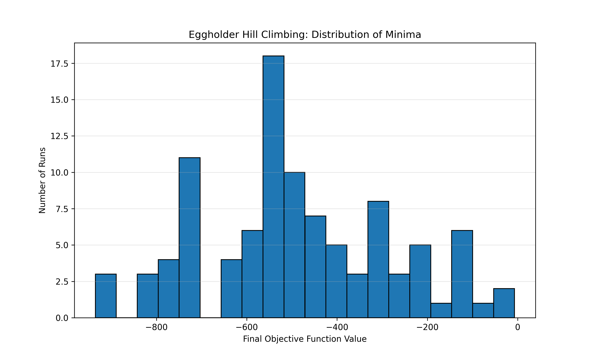

# Module 3: Local Search — Experimental Analysis

## 1. Introduction

This assignment explores the effectiveness of Hill Climbing as a local search algorithm through two optimization problems: the Eggholder function and the N-Queens problem.

The objective was to evaluate how well Hill Climbing could minimize an objective function, how frequently it found optimal solutions, and how its performance changed as the search space became more complex.

## 2. Eggholder Function Analysis

### Experimental Results

The Eggholder function was evaluated across 100 independent Hill Climbing trials, each beginning at a randomly selected point within the search domain.

| Metric | Result |
|---|---:|
| Best minimum | -959.628317 |
| Worst minimum | 523.675778 |
| Mean minimum | -475.723075 |
| Median minimum | -507.873732 |
| Known global minimum | -959.640663 |

The best observed minimum was approximately 0.012346 above the known global minimum, demonstrating that Hill Climbing was capable of finding a nearly optimal solution.

However, the substantial difference between the best and worst results indicates that the algorithm's performance was highly dependent on its starting location.

### Distribution of Results

The histogram displays the distribution of final function values obtained from the 100 trials.

The results show that Hill Climbing did not consistently converge to the same minimum. Instead, different starting positions produced different final objective values.

This behavior is consistent with the Eggholder function's highly irregular optimization landscape, which contains numerous local minima.

### Limitations

Hill Climbing only accepts improvements to the current solution. Consequently, once it reaches a region where its sampled neighboring moves fail to produce a lower function value, the algorithm may stop without discovering a better solution elsewhere.

The termination condition of 100 consecutive unsuccessful improvement attempts also means that the algorithm can stop before reaching an exact mathematical local minimum.

Although multiple random starting positions increased the likelihood of discovering a strong solution across the experiment, individual runs remained sensitive to initialization.

## 3. N-Queens Analysis

### Experimental Results

The N-Queens algorithm was tested using three board sizes, with 100 independent trials for each.

| Board size | Successful solutions | Failed attempts | Success rate |
|---|---:|---:|---:|
| N = 8 | 11 | 89 | 11% |
| N = 16 | 2 | 98 | 2% |
| N = 32 | 1 | 99 | 1% |

A successful trial required the algorithm to reach zero attacking queen pairs.

### Effect of Board Size

The results indicate that the success rate decreased as the board size increased.

For the 8-Queens problem, the algorithm successfully found valid arrangements in 11 out of 100 trials.

For the 16-Queens problem, only two trials reached a valid solution.

For the 32-Queens problem, only one trial succeeded.

These results suggest that the implemented Hill Climbing approach became less reliable as the search space increased.

However, the observed trend applies to this implementation and experimental sample; it does not establish that all local search methods become less effective for larger N-Queens problems.

### Local Minima

The most significant limitation was the algorithm's tendency to become trapped in local minima.

For example, in the first 8-Queens trial, the number of attacking pairs decreased from 8 to 1 in four improving moves.

Similarly, the first 16-Queens trial decreased from 19 attacking pairs to 3, while the first 32-Queens trial decreased from 36 to 2.

Although these trials failed to find complete solutions, they demonstrate that Hill Climbing was effective at improving the initial board configurations.

The algorithm terminated when no single-queen move could further reduce the number of attacking pairs.

Because the implementation does not allow sideways moves, worsening moves, or random restarts within an individual trial, it cannot escape these local minima.

### Board Visualizations

The initial and final chessboards for the first ten trials of each board size were saved in the `nqueens_plots/` directory.

Each image displays the initial configuration alongside the final configuration, allowing the reduction in attacking pairs to be examined visually.

The plots demonstrate that the algorithm often produced substantially improved arrangements, even when it did not achieve a valid solution.

## 4. Comparison of the Two Problems

Both experiments demonstrate the strengths and weaknesses of Hill Climbing.

In the Eggholder problem, the algorithm searched a continuous two-dimensional space and attempted to minimize a mathematical function.

In the N-Queens problem, the algorithm searched a discrete configuration space and attempted to minimize the number of attacking queen pairs.

Despite these differences, both algorithms depended on local improvements and were vulnerable to becoming trapped in suboptimal configurations.

An important difference was their termination behavior. The Eggholder implementation stopped after 100 consecutive unsuccessful improvement attempts, while the N-Queens implementation stopped when no strictly improving neighboring board existed.

The experiments also demonstrate that reducing the objective function does not necessarily mean reaching its global optimum.

## 5. Potential Improvements

Several modifications could improve the algorithms' ability to find optimal solutions.

**Random-Restart Hill Climbing:** Restart the search from a new random configuration whenever a local minimum is reached. This would allow multiple attempts within a larger search procedure.

**Sideways Moves:** Permit moves that maintain the current objective value. This could help the algorithm move across plateaus, although limits would be necessary to prevent cycles.

**Simulated Annealing:** Occasionally accept worse solutions according to a probability that decreases over time. This could help the search escape local minima.

These approaches could be compared experimentally against the basic Hill Climbing implementations.

## 6. Conclusion

The experiments demonstrated that Hill Climbing can efficiently improve candidate solutions but does not guarantee global optimality.

For the Eggholder function, the best trial approached the known global minimum, but the wide range of observed results demonstrated sensitivity to initialization.

For N-Queens, success rates declined from 11% for N=8 to 1% for N=32. Although the algorithm frequently reduced attacking pairs, it often terminated before reaching zero conflicts.

Overall, these findings highlight the importance of local minima, neighborhood design, termination conditions, and random initialization in local search algorithms.